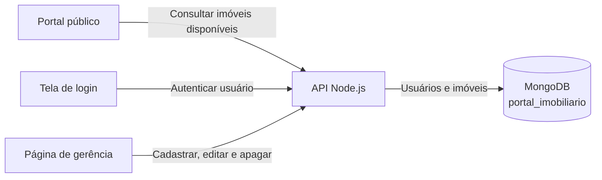
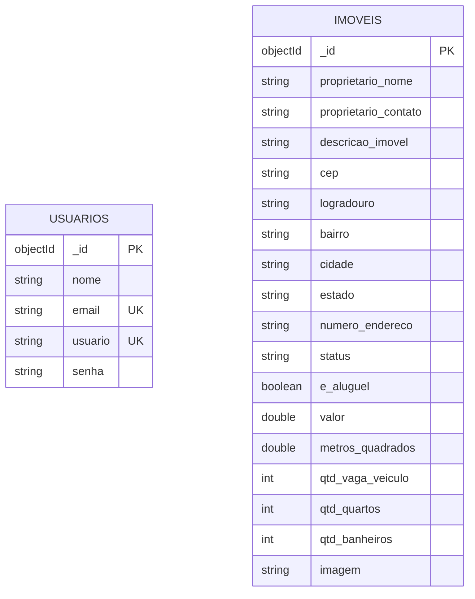
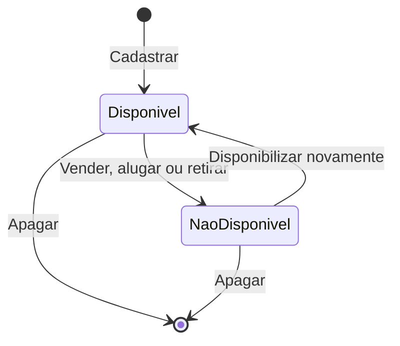
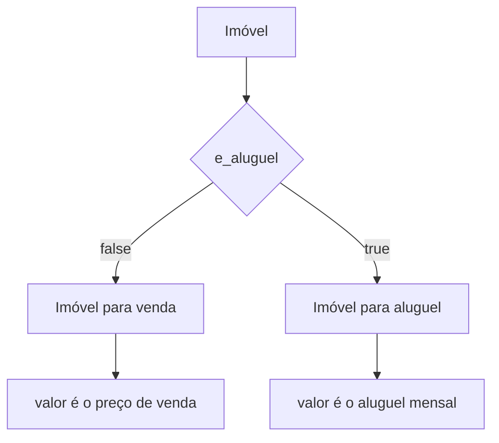
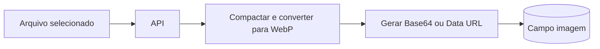
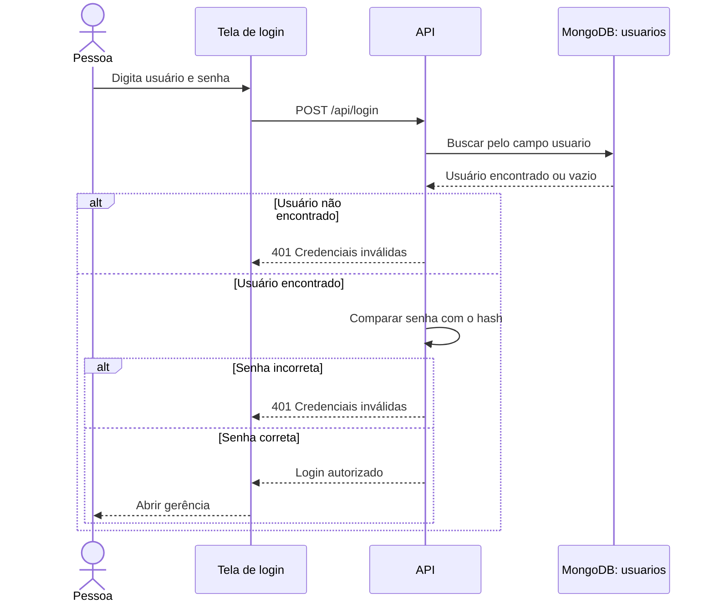
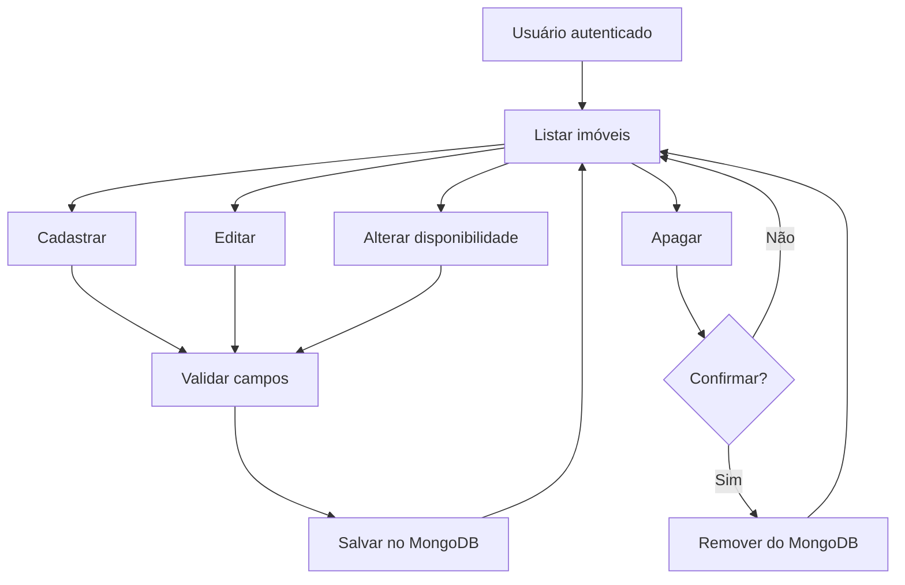
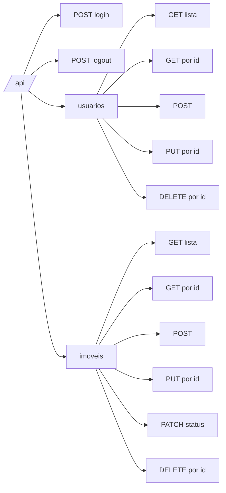

# Portal Imobiliário — Estrutura do Banco e Contrato da API

## 1. Objetivo

Este documento define a estrutura simples acordada para o MongoDB e o contrato inicial da API.

```text
portal_imobiliario
├── usuarios
└── imoveis
```

Os campos usam português, sem acentos, no padrão `snake_case`.

## 2. Decisões do modelo

- O `id` solicitado corresponde ao `_id` criado automaticamente pelo MongoDB.
- O campo `senha` guarda o hash da senha, nunca a senha aberta.
- O campo `imagem` é uma `string` longa com Base64 ou Data URL.
- O documento MongoDB completo, incluindo a imagem, não pode ultrapassar 16 MiB.
- `valor` usa o tipo `double` e ponto decimal no banco/API.
- A interface converte o valor para o formato brasileiro com vírgula.
- `e_aluguel: true` representa aluguel; `false` representa venda.

## 3. Arquitetura



## 4. Modelo das coleções



As coleções não possuem relacionamento obrigatório neste modelo inicial.

## 5. Coleção `usuarios`

| Campo solicitado | Campo MongoDB | Tipo | Obrigatório | Regra |
|---|---|---|---:|---|
| `id` | `_id` | `objectId` | Sim | Gerado automaticamente |
| `nome` | `nome` | `string` | Sim | Nome do usuário |
| `email` | `email` | `string` | Sim | Deve ser único |
| `usuario` | `usuario` | `string` | Sim | Deve ser único |
| `senha` | `senha` | `string` | Sim | Guarda somente o hash |

### Exemplo

```javascript
{
  _id: ObjectId("..."),
  nome: "Administrador",
  email: "admin@exemplo.com",
  usuario: "admin",
  senha: "$2b$12$hash_da_senha"
}
```

### Índices

```javascript
db.usuarios.createIndex(
  { email: 1 },
  { unique: true, name: "email_unico" }
)

db.usuarios.createIndex(
  { usuario: 1 },
  { unique: true, name: "usuario_unico" }
)
```

## 6. Coleção `imoveis`

| Campo solicitado | Campo MongoDB | Tipo | Obrigatório | Regra |
|---|---|---|---:|---|
| `id` | `_id` | `objectId` | Sim | Gerado automaticamente |
| `proprietario_nome` | `proprietario_nome` | `string` | Sim | Nome do proprietário |
| `proprietario_contato` | `proprietario_contato` | `string` | Sim | Telefone ou outro contato |
| `descricao_imovel` | `descricao_imovel` | `string` | Sim | Descrição do imóvel |
| `cep` | `cep` | `string` | Sim | Texto para preservar zeros |
| `logradouro` | `logradouro` | `string` | Sim | Rua, avenida ou equivalente |
| `bairro` | `bairro` | `string` | Sim | Bairro do imóvel |
| `cidade` | `cidade` | `string` | Sim | Cidade do imóvel |
| `estado` | `estado` | `string` | Sim | Sigla com dois caracteres |
| `numero_endereco` | `numero_endereco` | `string` | Sim | Permite números e `S/N` |
| `status` | `status` | `string` | Sim | `disponivel` ou `nao_disponivel` |
| `e_aluguel` | `e_aluguel` | `boolean` | Sim | `true` aluguel; `false` venda |
| `valor` | `valor` | `double` | Sim | Maior que zero; até duas casas |
| `metros_quadrados` | `metros_quadrados` | `double` | Sim | Maior que zero |
| `qtd_vaga_veiculo` | `qtd_vaga_veiculo` | `int` | Sim | Zero ou maior |
| `qtd_quartos` | `qtd_quartos` | `int` | Sim | Zero ou maior |
| `qtd_banheiros` | `qtd_banheiros` | `int` | Sim | Zero ou maior |
| `imagem` | `imagem` | `string` | Sim | Base64 ou Data URL compactada |

### Exemplo de imóvel para venda

```javascript
{
  _id: ObjectId("..."),
  proprietario_nome: "Maria da Silva",
  proprietario_contato: "(19) 99999-9999",
  descricao_imovel: "Casa com três quartos e garagem.",
  cep: "13600-000",
  logradouro: "Rua Exemplo",
  bairro: "Centro",
  cidade: "Araras",
  estado: "SP",
  numero_endereco: "150",
  status: "disponivel",
  e_aluguel: false,
  valor: 599000.00,
  metros_quadrados: 185.50,
  qtd_vaga_veiculo: 2,
  qtd_quartos: 3,
  qtd_banheiros: 2,
  imagem: "data:image/webp;base64,UklGR..."
}
```

### Exemplo de imóvel para aluguel

```javascript
{
  _id: ObjectId("..."),
  proprietario_nome: "João dos Santos",
  proprietario_contato: "(19) 98888-8888",
  descricao_imovel: "Apartamento com dois quartos.",
  cep: "13601-000",
  logradouro: "Avenida Exemplo",
  bairro: "Jardim Universitário",
  cidade: "Araras",
  estado: "SP",
  numero_endereco: "320",
  status: "disponivel",
  e_aluguel: true,
  valor: 2500.00,
  metros_quadrados: 72.00,
  qtd_vaga_veiculo: 1,
  qtd_quartos: 2,
  qtd_banheiros: 1,
  imagem: "data:image/webp;base64,UklGR..."
}
```

### Índices

```javascript
db.imoveis.createIndex(
  { status: 1 },
  { name: "imoveis_por_status" }
)

db.imoveis.createIndex(
  { e_aluguel: 1, status: 1 },
  { name: "imoveis_por_finalidade_e_status" }
)

db.imoveis.createIndex(
  { cidade: 1, bairro: 1, status: 1 },
  { name: "imoveis_por_localizacao_e_status" }
)

db.imoveis.createIndex(
  { valor: 1 },
  { name: "imoveis_por_valor" }
)

db.imoveis.createIndex(
  { qtd_quartos: 1 },
  { name: "imoveis_por_quartos" }
)
```

## 7. Situação do imóvel



Valores gravados:

```text
disponivel
nao_disponivel
```

O portal consulta somente:

```javascript
{ status: "disponivel" }
```

Este modelo simples não informa se a indisponibilidade aconteceu por venda, aluguel ou retirada manual.

## 8. Venda ou aluguel



- `e_aluguel: false`: imóvel para venda.
- `e_aluguel: true`: imóvel para aluguel.
- O imóvel não pode ser simultaneamente para venda e aluguel.

## 9. Imagem no MongoDB



Regras recomendadas:

- Uma imagem por imóvel neste primeiro modelo.
- Aceitar JPEG, PNG e WebP.
- Não aceitar SVG.
- Redimensionar e converter para WebP.
- Validar o conteúdo real do arquivo.
- Manter o documento abaixo do limite de 16 MiB.

## 10. Login



## 11. Gerenciamento de imóveis



## 12. Endpoints iniciais

### Login

| Método | Endpoint | Função |
|---|---|---|
| `POST` | `/api/login` | Autenticar usuário |
| `POST` | `/api/logout` | Encerrar autenticação |

### Usuários

| Método | Endpoint | Função |
|---|---|---|
| `GET` | `/api/usuarios` | Listar usuários |
| `GET` | `/api/usuarios/:id` | Consultar usuário |
| `POST` | `/api/usuarios` | Cadastrar usuário |
| `PUT` | `/api/usuarios/:id` | Editar usuário |
| `DELETE` | `/api/usuarios/:id` | Apagar usuário |

### Imóveis

| Método | Endpoint | Função |
|---|---|---|
| `GET` | `/api/imoveis` | Listar imóveis |
| `GET` | `/api/imoveis/:id` | Consultar imóvel |
| `POST` | `/api/imoveis` | Cadastrar imóvel |
| `PUT` | `/api/imoveis/:id` | Editar imóvel |
| `PATCH` | `/api/imoveis/:id/status` | Alterar disponibilidade |
| `DELETE` | `/api/imoveis/:id` | Apagar imóvel |

## 13. Mapa da API



## 14. Exemplo de cadastro pela API

```json
{
  "proprietario_nome": "Maria da Silva",
  "proprietario_contato": "(19) 99999-9999",
  "descricao_imovel": "Casa com três quartos e garagem.",
  "cep": "13600-000",
  "logradouro": "Rua Exemplo",
  "bairro": "Centro",
  "cidade": "Araras",
  "estado": "SP",
  "numero_endereco": "150",
  "status": "disponivel",
  "e_aluguel": false,
  "valor": 599000.00,
  "metros_quadrados": 185.50,
  "qtd_vaga_veiculo": 2,
  "qtd_quartos": 3,
  "qtd_banheiros": 2,
  "imagem": "data:image/webp;base64,UklGR..."
}
```

## 15. Respostas da API

### Sucesso

```json
{
  "sucesso": true,
  "dados": {},
  "mensagem": "Operação realizada com sucesso."
}
```

### Erro

```json
{
  "sucesso": false,
  "erro": {
    "codigo": "DADOS_INVALIDOS",
    "mensagem": "Existem campos inválidos.",
    "campos": {
      "valor": "O valor deve ser maior que zero."
    }
  }
}
```

## 16. Contrato compartilhado

```text
Coleção: usuarios
Campos: _id, nome, email, usuario, senha

Coleção: imoveis
Campos: _id, proprietario_nome, proprietario_contato,
        descricao_imovel, cep, logradouro, bairro, cidade,
        estado, numero_endereco, status, e_aluguel, valor,
        metros_quadrados, qtd_vaga_veiculo, qtd_quartos,
        qtd_banheiros, imagem

Status: disponivel | nao_disponivel
Venda: e_aluguel = false
Aluguel: e_aluguel = true
Valor: double
Imagem: string longa
```

Não alterar sem acordo entre os responsáveis:

- Nome das coleções.
- Nome e tipo dos campos.
- Valores possíveis para `status`.
- Significado de `e_aluguel`.
- Formato de `valor`.
- Forma de armazenamento de `imagem`.

## 17. Limitações conhecidas do modelo simples

1. `status: "nao_disponivel"` não diferencia vendido, alugado ou retirado.
2. `imagem` permite somente uma imagem por imóvel.
3. Base64 aumenta o tamanho do arquivo armazenado.
4. O documento completo não pode ultrapassar 16 MiB.
5. A exclusão remove o imóvel definitivamente.
6. Não existe histórico de alterações.
7. Não existe vínculo entre o usuário e o imóvel cadastrado.

